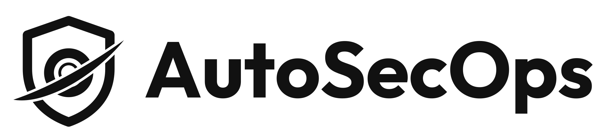

  <picture>
    <source media="(prefers-color-scheme: dark)" srcset="img/banner-dark.svg">
    <source media="(prefers-color-scheme: light)" srcset="img/banner-light.svg">
    
  </picture>
  

    The agentic security automation platform.
  

   

## Introduction

AutoSecOps is the AI-native security automation platform for teams and AI agents, built and owned by [SingularityRD](https://github.com/SingularityRD). A unified platform with everything AI-native security teams need to build agents and automate cyber defense.

## Core Features

Unlimited agents, cases, lookup tables, and workflows.

<table>
  <tr>
    <td width="50%" valign="top">
      
      
<b>Agents and skills</b> — build custom agents with prompts, tools, MCP, subagents, and skills

    </td>
    <td width="50%" valign="top">
      
      
<b>Case management</b> — track, automate, and resolve incidents with agents

    </td>
  </tr>
  <tr>
    <td width="50%" valign="top">
      
      
<b>Workflows</b> — execute deterministic logic with resilience and scale on Temporal

    </td>
    <td width="50%" valign="top">
      
      
<b>Tables</b> — store and query structured data

    </td>
  </tr>
  <tr>
    <td width="50%" valign="top">
      
      
<b>AutoSecOps MCP</b> — turn prompts into automations from Claude Code, Codex, Copilot, and more

    </td>
    <td width="50%" valign="top">
      
      
<b>Integrations</b> — 100+ pre-built connectors and 50+ hosted MCP servers for security tools

    </td>
  </tr>
</table>

## Other Highlights

- **Pre-built MCP servers**: 50+ AutoSecOps-hosted MCP servers for security operations
- **MCP client**: connect custom agents to any MCP server (remote HTTP / OAuth or local via `npx` / `uvx` commands)
- **Custom registry**: sync custom Python scripts from your Git repo into AutoSecOps
- **Sandboxed**: run untrusted code and agents within `nsjail` sandboxes or `pid` runtimes
- **Durable execution**: built on [Temporal](https://temporal.io) for resilience and scale
- **Variables**: reuse values across workflows and agents
- **No SSO tax**: SAML / OIDC support
- **Free audit logs**: exportable into your SIEM
- **Deploy anywhere**: self-host with Docker Compose, AWS Fargate, or Kubernetes. Runs fully [air-gapped](https://github.com/SingularityRD/AutoSecOps1/blob/main/docs/self-hosting/air-gapped.mdx).

## Enterprise Features

- **Multi-tenant**: isolate different teams and dev / prod environments into workspaces
- **Fine-grained access control**: RBAC, ABAC, OAuth2.0 scopes for humans and agents
- **Human-in-the-loop**: review and approve sensitive tool calls from a unified inbox, Slack, or email
- **Workspace version control**: sync workflows, agents, and table schemas to GitHub, GitLab, Bitbucket, etc.
- **Metrics and monitoring**: for workflows, agents, and cases

> [!NOTE]
> AutoSecOps is deployed self-hosted on your own infrastructure with Docker Compose, AWS Fargate, or Kubernetes. See the [self-hosting docs](https://github.com/SingularityRD/AutoSecOps1/tree/main/docs/self-hosting).
> Contact [SingularityRD](https://github.com/SingularityRD) for licensing and deployment options.

## Tech Stack

- Backend: Python with FastAPI, SQLAlchemy, Pydantic, uv
- Frontend: Next.js with TypeScript, React Query, Shadcn UI
- Durable workflows and jobs: Temporal
- Sandbox: nsjail
- Database: PostgreSQL
- Object store: S3-compatible

## Contributing

Check out the [Contribution Guide](CONTRIBUTING.md) for development setup and conventions.

## License

AutoSecOps is proprietary software owned by SingularityRD. All rights reserved.
The entire repository, including `packages/tracecat-ee`, is covered by the single SingularityRD proprietary license in [LICENSE](LICENSE).
Use, copying, modification, or distribution requires a written license agreement with SingularityRD.
Third-party components remain under their respective licenses.

 

  **`AutoSecOps`** &copy; SingularityRD. All rights reserved.

