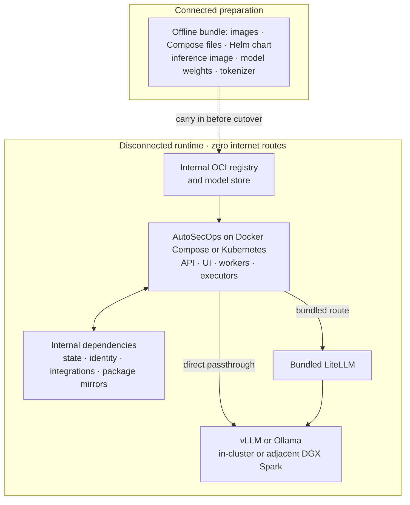

<Info>
  Every AutoSecOps feature works in self-hosted and air-gapped deployments.
</Info>

AutoSecOps runs with zero internet connectivity on Docker Compose and Kubernetes. Use the offline bundle to carry every image, install file, and chart into the disconnected network, then point AutoSecOps at your internal registry, LLM endpoint, and package mirrors.

## Reference architecture

The inference service can run next to AutoSecOps or on an adjacent private GPU cluster. Every runtime connection stays on customer-controlled networks.



## Prepare while connected

- Get the [offline bundle](#offline-bundle) for your AutoSecOps version. Build it with the GHCR access SingularityRD granted you, as described in [Registry access](/self-hosting/kubernetes#registry-access).
- Stage the inference image, model weights, tokenizer, and model configuration in internal repositories. The offline bundle does not include model weights.
- Provision internal DNS, TLS certificates, and identity. On Kubernetes, also provision PostgreSQL with pgvector, Redis, S3-compatible storage, and Temporal; Docker Compose runs these from the bundled images.
- Mirror the PyPI and npm packages your workflows and MCP servers install. See [Mirror PyPI and npm](#mirror-pypi-and-npm).
- Validate image pulls, model discovery, and package installs before you remove egress.

No runtime workflow, integration, telemetry exporter, identity provider, or package dependency may require a public endpoint.

The UI ships MCP catalog icons inside its bundle, and the API serves the Swagger UI (`/api/docs`) and ReDoc (`/api/redoc`) pages from assets in its image, so both work without internet access.

## Offline bundle

The offline bundle is one archive, `autosecops-offline-<version>.tar.zst` (`.tar.gz` when the build host lacks `zstd`), with a `.sha256` checksum file beside it. It extracts to `autosecops-offline-<version>/`:

| Path | Contents |
| --- | --- |
| `images/` | Every image the Compose stack and Helm chart run, saved with `docker save` for one platform (`linux/amd64` by default) |
| `images.txt` | Tab-separated manifest: name, tag, digest, loaded reference, archive, Compose variable, Helm value |
| `install/` | `docker-compose.yml`, `docker-compose.sandbox.yml`, `Caddyfile`, `.env.example`, `env.sh`, `env-migration.sh`, `backup_compose.sh`, `restore_compose.sh`, `support_bundle.sh` |
| `charts/autosecops-<version>.tgz` | The Helm chart |
| `load-images.sh` | Verifies the bundle, loads the images, and pushes them to an internal registry |
| `THIRD_PARTY_NOTICES/` | Licenses of AutoSecOps dependencies and of every bundled third-party image |
| `README.md` | Short load and install steps |
| `SHA256SUMS` | SHA-256 of every file, plus `SHA256SUMS.sig` or `SHA256SUMS.minisig` when the bundle is signed |

The bundle carries these images. `images.txt` records the digest each one was pinned to when the bundle was built.

| Image | Docker Compose variable | Helm value |
| --- | --- | --- |
| `ghcr.io/singularityrd/autosecops` | `AUTOSECOPS__IMAGE_REPOSITORY` | `image.repository` |
| `ghcr.io/singularityrd/autosecops-ui` | `AUTOSECOPS__UI_IMAGE_REPOSITORY` | `uiImage.repository` |
| `ghcr.io/singularityrd/autosecops-tunnel-gateway` | — | `tunnels.gateway.image.repository` |
| `ghcr.io/singularityrd/autosecops-postgres` | `AUTOSECOPS__PGVECTOR_IMAGE` | — |
| `caddy` | `AUTOSECOPS__CADDY_IMAGE` | — |
| `postgres` (Temporal database) | `TEMPORAL__POSTGRES_IMAGE` | — |
| `temporalio/auto-setup` | `TEMPORAL__IMAGE_REPOSITORY` | — |
| `temporalio/ui` | `TEMPORAL__UI_IMAGE_REPOSITORY` | — |
| `cgr.dev/chainguard/minio` | `AUTOSECOPS__MINIO_IMAGE` | — |
| `valkey/valkey` (the `redis` service) | `AUTOSECOPS__REDIS_IMAGE` | — |

`*_IMAGE_REPOSITORY` variables take a repository without a tag; the tag comes from `AUTOSECOPS__IMAGE_TAG`, `TEMPORAL__VERSION`, or `TEMPORAL__UI_VERSION`. The other variables take a full image reference.

### Build a bundle

Ask your SingularityRD contact for the bundle of your version, or build it on a connected Linux or macOS host with Docker, `uv`, `just`, and access to the AutoSecOps images:

```bash
git clone https://github.com/SingularityRD/AutoSecOps1.git
cd AutoSecOps1
git checkout <version>
docker login ghcr.io          # only if the images are private
just offline-bundle <version>
```

The bundle lands in `dist/`. Add `--platform linux/arm64` for arm64 hosts. The builder reads the image list from the checked-out `docker-compose.yml` and chart, so it refuses a version that differs from the checkout. Add `--dry-run` to list the images without pulling them.

To sign the bundle, set one of these before you build. The builder signs `SHA256SUMS` and the archive checksum, and never copies the private key into the bundle. Add `--require-signature` to make the build fail when no key is set; SingularityRD release bundles are always built with it:

| Variable | Value |
| --- | --- |
| `OFFLINE_BUNDLE_COSIGN_KEY` | cosign key reference, e.g. `cosign.key` or a KMS URI. Set `COSIGN_PASSWORD` for an encrypted key. Requires cosign 3.0 or later |
| `OFFLINE_BUNDLE_MINISIGN_KEY` | minisign secret key file. Set `MINISIGN_PASSWORD` for an encrypted key |
| `OFFLINE_BUNDLE_COSIGN_PUBLIC_KEY` or `OFFLINE_BUNDLE_MINISIGN_PUBLIC_KEY` | Optional public key file to include as `cosign.pub` or `minisign.pub` |

cosign signatures are detached and are not uploaded to a public transparency log, so a bundle build is never announced publicly and verification works without network access. Next to the archive, the builder also writes `autosecops-offline-<version>.SHA256SUMS` (a copy of the bundle's `SHA256SUMS`) and the signatures of both checksum files.

### Release bundles from CI

SingularityRD builds release bundles with the `Build offline bundle` workflow (`.github/workflows/build-offline-bundle.yml`). The bundle contains every AutoSecOps image, so the workflow never uploads it as a GitHub Actions artifact. It signs the bundle, verifies the signatures, and uploads it to a private S3 bucket; only the checksum files, their signatures, and the public key become a workflow artifact.

The workflow refuses to start until the protected `offline-bundle` GitHub environment holds:

| Setting | Kind | Value |
| --- | --- | --- |
| `OFFLINE_BUNDLE_S3_URI` | Variable | `s3://<bucket>/<prefix>`. Each release lands under `<prefix>/<version>/`; a version that already exists is never overwritten |
| `OFFLINE_BUNDLE_AWS_ROLE_ARN` | Variable | IAM role the workflow assumes through GitHub OIDC |
| `OFFLINE_BUNDLE_AWS_REGION` | Variable | Region of the bucket and KMS key |
| `OFFLINE_BUNDLE_S3_KMS_KEY_ARN` | Variable | Optional. ARN of the customer-managed KMS key that encrypts the uploaded objects, such as `arn:aws:kms:eu-central-1:123456789012:key/<key-id>`. When unset, the workflow sends no encryption header and the bucket's default encryption applies |
| `OFFLINE_BUNDLE_COSIGN_KMS_KEY` | Variable | `awskms://` URI of an asymmetric signing key (recommended: the private key never leaves KMS) |
| `OFFLINE_BUNDLE_COSIGN_PRIVATE_KEY` and `OFFLINE_BUNDLE_COSIGN_PASSWORD` | Secrets | cosign-encrypted private key and its password, used only when no KMS key is set |

Set up AWS once:

1. Create a private bucket with Block Public Access on, default SSE-KMS encryption with a customer-managed key, versioning, and a lifecycle or Object Lock policy that matches your retention rules.
2. Create an IAM role whose trust policy accepts `token.actions.githubusercontent.com` with audience `sts.amazonaws.com` and subject `repo:<owner>/<repository>:environment:offline-bundle`, so only this environment can assume it. Set its maximum session duration to at least 2 hours.
3. Grant the role `s3:ListBucket` on the bucket (limited to the prefix), `s3:PutObject` on `<prefix>/*`, `kms:GenerateDataKey` and `kms:Decrypt` on the bucket's encryption key (multipart uploads of the multi-GB archive need both), and, for KMS signing, `kms:Sign` and `kms:GetPublicKey` on the signing key. Do not grant `s3:DeleteObject`.
4. Give the `offline-bundle` environment required reviewers and restrict it to release tags.

Deliver bundles to customers from the bucket with short-lived presigned URLs or your secure file transfer service, and send the public key (`autosecops-offline-<version>.cosign.pub`) through a separate channel so customers can authenticate what they receive.

## Verify the bundle

Authenticate the archive checksum with SingularityRD's public key, check the archive before you extract it, then check every file and the signature:

```bash
cosign verify-blob --key /path/to/cosign.pub --insecure-ignore-tlog=true \
  --signature autosecops-offline-<version>.tar.zst.sha256.sig \
  autosecops-offline-<version>.tar.zst.sha256
sha256sum -c autosecops-offline-<version>.tar.zst.sha256
tar -xf autosecops-offline-<version>.tar.zst
cd autosecops-offline-<version>
./load-images.sh verify --cosign-key /path/to/cosign.pub    # or --minisign-key
```

Get the public key from SingularityRD through a channel other than the bundle: a `cosign.pub` inside the bundle only proves that the bundle matches the key it carries. `verify` without a key checks `SHA256SUMS` only. `--insecure-ignore-tlog=true` is expected: the bundle is signed without a public transparency-log entry, and the public key is the trust root, so verification needs no network access.

## Load the images

On a Docker Compose host, load every image into the local Docker engine:

```bash
./load-images.sh load
```

`load` prints the `.env` lines Docker Compose needs. Images pinned by digest, such as MinIO, load under a tag that includes the digest, e.g. `AUTOSECOPS__MINIO_IMAGE=cgr.dev/chainguard/minio:latest-6a1d0b45c866`.

## Push to an internal registry

To serve the images from Harbor, Nexus, Artifactory, or any OCI registry, log in and push them under one repository prefix:

```bash
docker login registry.example.internal
./load-images.sh push registry.example.internal/autosecops
```

`push` loads each image, keeps its repository path under your prefix (`ghcr.io/singularityrd/autosecops` becomes `registry.example.internal/autosecops/singularityrd/autosecops`), and prints the settings for both install methods:

```bash
# Docker Compose: add to the .env next to docker-compose.yml
AUTOSECOPS__IMAGE_REPOSITORY=registry.example.internal/autosecops/singularityrd/autosecops
AUTOSECOPS__UI_IMAGE_REPOSITORY=registry.example.internal/autosecops/singularityrd/autosecops-ui
AUTOSECOPS__REDIS_IMAGE=registry.example.internal/autosecops/valkey/valkey:8.1.10-alpine@sha256:...

# Helm: save as registry-values.yaml and pass it with -f
image:
  repository: registry.example.internal/autosecops/singularityrd/autosecops
uiImage:
  repository: registry.example.internal/autosecops/singularityrd/autosecops-ui
```

Create the Harbor project, or the Nexus or Artifactory Docker repository, first. Add `--dry-run` to print the plan without loading or pushing. The script uses your existing `docker login` and never prints credentials.

## Install with Docker Compose

```bash
mkdir -p /opt/autosecops
cp -r install/. /opt/autosecops/
cd /opt/autosecops
chmod +x env.sh && ./env.sh
```

Append the lines `load` or `push` printed to `.env`, then continue with [Docker Compose](/self-hosting/docker-compose) from Generate the .env file onward. Skip its Extract configuration files step: `install/` holds the same files. Start AutoSecOps with `docker compose up -d`.

Give Caddy an internal certificate. A domain in `BASE_DOMAIN` makes Caddy request a Let's Encrypt certificate, which fails offline. See [Bring your own certificate](/self-hosting/tls#bring-your-own-certificate).

## Install with Helm

Push the images first, then install the chart from the bundle with the printed `registry-values.yaml`:

```bash
helm install autosecops charts/autosecops-<version>.tgz \
  --namespace autosecops --create-namespace \
  -f values.yaml -f registry-values.yaml \
  --wait --timeout 15m
```

If your registry needs credentials, create a pull Secret and list it in `imagePullSecrets`, and in `tunnels.gateway.imagePullSecrets` for tunnel gateways. See [Container images](/self-hosting/kubernetes#container-images). To serve the chart from your registry too, run `helm push charts/autosecops-<version>.tgz oci://registry.example.internal/autosecops/charts`.

## Install the license key

AutoSecOps verifies the license key's signature locally against a public key built into the image, so a license works without any connection to SingularityRD. Install it as described in [License key](/self-hosting/license): `AUTOSECOPS__LICENSE_KEY` in `.env` for Docker Compose, or `licenseKey` in the core Secret for Helm.

## Connect an internal LLM endpoint

Point agents at an internal OpenAI-compatible endpoint such as vLLM, Ollama, or your own LiteLLM gateway:

1. Allow the endpoint's address. AutoSecOps rejects private addresses until you list them: set `AUTOSECOPS__OUTBOUND_ALLOWED_PRIVATE_CIDRS=10.0.12.34/32` in `.env`, or `autosecops.outboundAllowedPrivateCidrs` in Helm values. See [Private endpoints](/agents/llm-providers#private-endpoints).
2. In Organization settings > Agent > Configuration, connect the vLLM, Ollama, or LiteLLM provider with a base URL that ends in `/v1`, e.g. `http://vllm.example.internal:8000/v1`, or add a [custom LLM provider](/agents/custom-llm-providers).
3. Allow the discovered models and set the default model.
4. Send a representative agent request after you remove egress.

### Choose the model route

Configure the route per agent, including subagents.

| Route | Choose it when | Request path |
| --- | --- | --- |
| Direct passthrough | You already operate an OpenAI-compatible endpoint and want the shortest path or per-agent routing. | Agent executor → internal vLLM or Ollama |
| Bundled LiteLLM | You want centralized model aliases, credentials, request normalization, or multiple inference backends. | Agent executor → bundled LiteLLM → internal inference |

Use [vLLM](https://docs.vllm.ai/en/stable/serving/parallelism_scaling/) as the distributed production option; confirm its model-specific [tool parser](https://docs.vllm.ai/en/stable/features/tool_calling/). Use Ollama as the simpler quantized or single-server option; review its [GPU](https://docs.ollama.com/gpu), [context](https://docs.ollama.com/context-length), [model import](https://docs.ollama.com/import), and [tool-calling](https://docs.ollama.com/capabilities/tool-calling) guidance. Ollama models tagged `:cloud` require the Ollama cloud service and cannot serve requests without egress.

### Open model reference

Reviewed September 2026. Each [DGX Spark](https://docs.nvidia.com/dgx/dgx-spark/hardware.html) provides 128 GB of unified memory. Static weight figures exclude KV cache, serving overhead, and concurrency. Calculated figures use two bytes per BF16 parameter, one byte per FP8 parameter, and half a byte per FP4 parameter. Context is the total window for input, reasoning, and response. Generation figures are vendor recommendations, not separate hard output limits.

| Model | Compute against 2–3 DGX Spark nodes | Size and precision | Tool calling | Context / recommended generation | Defensive cyber evidence |
| --- | --- | --- | --- | --- | --- |
| [Gemma 4 26B A4B](https://ai.google.dev/gemma/docs/core) | Published load: 57.7 GB BF16, 28.8 GB SFP8, 14.4 GB Q4 | 25.2B total / 3.8B active | Native function calling; vLLM [`gemma4`](https://docs.vllm.ai/en/stable/api/vllm/tool_parsers/gemma4_engine_tool_parser/) parser | 256K / not published | Function calling published; defensive SOC result unavailable |
| [Gemma 4 31B](https://ai.google.dev/gemma/docs/core) | Published load: 69.9 GB BF16, 34.9 GB SFP8, 17.5 GB Q4 | 30.7B dense | Native function calling; vLLM [`gemma4`](https://docs.vllm.ai/en/stable/api/vllm/tool_parsers/gemma4_engine_tool_parser/) parser | 256K / not published | Function calling published; defensive SOC result unavailable |
| [Ministral 3 14B](https://huggingface.co/mistralai/Ministral-3-14B-Instruct-2512-BF16) | Published: under 32 GB BF16 or 24 GB quantized | 14B dense | Native function calling and JSON; vLLM `mistral` parser | 256K / not published | No checkpoint-specific defensive SOC result found |
| [Mistral Small 4 119B A6B](https://huggingface.co/mistralai/Mistral-Small-4-119B-2603) | Published NVFP4 repository: ≈70.8 GB; vLLM example uses TP2 | 119B total / 6.5B active, BF16 or NVFP4 | Native function calling and JSON; vLLM `mistral` parser | 256K / not published | Agentic results published; defensive SOC result unavailable |
| [Qwen3.8 27B](https://huggingface.co/Qwen/Qwen3.8-27B) | Published: 55.6 GB BF16 or [18 GB Ollama Q4](https://ollama.com/library/qwen3.8:27b) | 27B dense, BF16 or quantized | Native tool use; vLLM `qwen3_coder` parser | 262K native, 1M with YaRN / up to 262K reasoning content and 131K final response with separate serving limits | Agentic results published; defensive SOC result unavailable |
| [Qwen3.8-Flash-Next](https://huggingface.co/Qwen/Qwen3.8-Flash-Next) | Published [Ollama NVFP4 artifact](https://ollama.com/library/qwen3.8-flash-next:125b-a6b-nvfp4): 113 GB; no 2–3 Spark recipe found | 125B total / 6B active, plus 51B n-gram embeddings and 4B MTP | Native tool use; vLLM `qwen3_coder` parser | 262K native, 1M with YaRN / up to 262K reasoning content and 131K final response with separate serving limits | Toolathlon published; defensive SOC result unavailable |
| [GLM-4.7-Flash](https://huggingface.co/zai-org/GLM-4.7-Flash) | Calculated: ≈60 GB BF16 or 30 GB FP8 | 30B total / 3B active | Native; vLLM `glm47` parser | 200K / not published | No checkpoint-specific defensive SOC result found |
| [GLM-5.3-Flash](https://huggingface.co/zai-org/GLM-5.3-Flash) | Calculated: ≈320 GB FP8 or 160 GB NVFP4; [two-Spark NVFP4 reference](https://docs.nvidia.com/nim/vision-language-models/latest/deploy-on-dgx-spark.html) | 320B total / 18B active, FP8/MTP | Native; vLLM [`glm47` parser and dedicated image](https://recipes.vllm.ai/zai-org/GLM-5.3-Flash) | 1M / not published | AutomationBench published; defensive SOC result unavailable |
| [Kimi-Linear 48B A3B](https://github.com/MoonshotAI/Kimi-Linear) | Calculated: ≈96 GB BF16 or 48 GB FP8 | 48B total / 3B active | OpenAI-compatible serving; native tool-use evidence unavailable | 1M / not published | No checkpoint-specific defensive SOC result found |
| [Kimi K3](https://github.com/MoonshotAI/Kimi-K3) | vLLM reference: ≈1.68 TB across 16 GPUs; no 2–3 Spark reference | 2.8T total / 104B active, MXFP4 weights | vLLM `kimi_k3` parser; [Ollama is cloud-only](https://ollama.com/library/kimi-k3) | 1.05M / not published | [Defensive investigation coverage: 0.330](https://simbian.ai/research/cyber-defense-benchmark), with 0/13 ATT&CK tactics above 50% |

Cyber evidence means checkpoint-specific evaluation for defensive alert triage, investigation, structured tool use, or workflow generation. General reasoning, coding, and offensive-security scores are not substitutes. Track emerging defensive evaluations such as [SIABench](https://arxiv.org/abs/2603.06422) and [CyberSOCEval](https://arxiv.org/abs/2509.20166).

Qwen recommends these generation limits only for frameworks that expose separate controls for reasoning content and final responses within a 1M-token YaRN configuration. The limits are not additive to the context window: prompt, reasoning, and response tokens still share the total window. With a single `max_tokens` control, budget the entire generation within that window.

Treat static weight fit as a starting point, not a capacity guarantee. Validate target context length, KV cache, concurrency, latency, and serving overhead with your own workload.

## Mirror PyPI and npm

Python scripts (`core.script.run_python` with dependencies) and [custom registry](/custom-actions/custom-registry) sync install packages at runtime. Point them at an internal PyPI mirror and allow its address inside the sandbox:

| Setting | Docker Compose (`.env`) | Helm values |
| --- | --- | --- |
| Primary index | `AUTOSECOPS__SANDBOX_PYPI_INDEX_URL=https://pypi.example.internal/simple` | `autosecops.sandbox.pypiIndexUrl` |
| Extra indexes | `AUTOSECOPS__SANDBOX_PYPI_EXTRA_INDEX_URLS=https://a.example.internal/simple,https://b.example.internal/simple` | `autosecops.sandbox.pypiExtraIndexUrls` |
| Mirror address inside the sandbox | `AUTOSECOPS__SANDBOX_INSTALL_ALLOWED_EGRESS_CIDRS=10.0.20.5/32` | An `autosecops.extraEnv` entry with the same name |

The sandbox blocks private addresses during installs, so a mirror on your network needs the egress CIDR. On AWS Fargate, set the `sandbox_pypi_index_url` and `sandbox_pypi_extra_index_urls` Terraform variables. Host custom registry repositories on an internal Git server and allow it with `AUTOSECOPS__SANDBOX_REGISTRY_ALLOWED_EGRESS_CIDRS`.

Stdio MCP servers started with `npx` or `uvx` download their package when they start. Set the mirror in the MCP integration's environment variables: `NPM_CONFIG_REGISTRY=https://npm.example.internal/` for `npx`, and `UV_INDEX_URL=https://pypi.example.internal/simple` for `uvx`.

## Outbound connections

Every outbound connection below is off by default or goes to an endpoint you configure.

| Connection | Default | Air-gapped setting |
| --- | --- | --- |
| Sentry error reporting | Off | Leave `SENTRY_DSN` (Helm `sentryDsn` in the core Secret) empty, or point it at an internal Sentry |
| PostHog product analytics in the UI | Off | Leave `NEXT_PUBLIC_POSTHOG_KEY` empty |
| OpenTelemetry trace export | Off | Keep `AUTOSECOPS__PLATFORM_OTEL_ENABLED=false`, or point `OTEL_EXPORTER_OTLP_ENDPOINT` at an internal collector |
| Caddy certificates (Docker Compose) | Let's Encrypt for a domain in `BASE_DOMAIN` | [Bring your own certificate](/self-hosting/tls#bring-your-own-certificate) |
| LiteLLM model price list | Downloaded from GitHub when a service starts, with the copy in the image as fallback | `LITELLM_LOCAL_MODEL_COST_MAP=true` |
| Sandbox Python packages | `https://pypi.org/simple` | [Mirror PyPI and npm](#mirror-pypi-and-npm) |
| Stdio MCP server packages | Public npm and PyPI | [Mirror PyPI and npm](#mirror-pypi-and-npm) |
| Custom registry sync | The Git URL you configure | An internal Git server |
| LLM providers and remote MCP servers | The endpoints you configure | Internal endpoints listed in `AUTOSECOPS__OUTBOUND_ALLOWED_PRIVATE_CIDRS` |
| Audit webhooks, GitLab, and Bitbucket Data Center | The URLs you configure | Internal endpoints listed in `AUTOSECOPS__OUTBOUND_ALLOWED_PRIVATE_CIDRS` |
| License verification | Local | No setting needed |

Without network access, each service that loads LiteLLM waits for the price-list download to fail, up to three five-second attempts, before it uses the copy in the image. `LITELLM_LOCAL_MODEL_COST_MAP=true` skips the download. On Helm, pass it through `autosecops.extraEnv`:

```yaml
autosecops:
  extraEnv:
    - name: LITELLM_LOCAL_MODEL_COST_MAP
      value: "true"
```

On Docker Compose, add a `docker-compose.override.yml` next to `docker-compose.yml`. Compose merges it automatically:

```yaml
x-offline-env: &offline-env
  LITELLM_LOCAL_MODEL_COST_MAP: "true"
services:
  api: { environment: *offline-env }
  worker: { environment: *offline-env }
  executor: { environment: *offline-env }
  agent-worker: { environment: *offline-env }
  agent-executor: { environment: *offline-env }
  litellm: { environment: *offline-env }
  mcp: { environment: *offline-env }
```

Actions, agent skills, and integrations that call public SaaS APIs fail without egress. Point them at internal equivalents or leave them disabled.

## Update with a new bundle

<Steps>
  <Step title="Back up">
    Back up before every update. See [Back up](#back-up).
  </Step>
  <Step title="Verify and load the new bundle">
    Verify the new bundle, then run `./load-images.sh load` or `./load-images.sh push <registry>/<prefix>` again. Pushing a new version adds tags beside the old ones, so you can roll back.
  </Step>
  <Step title="Update Docker Compose">
    From the new `install/` directory, copy `env-migration.sh` and `.env.example` next to your `.env` and run `./env-migration.sh`. Replace `docker-compose.yml`, `docker-compose.sandbox.yml`, `Caddyfile`, `backup_compose.sh`, `restore_compose.sh`, and `support_bundle.sh` with the new copies, set `AUTOSECOPS__IMAGE_TAG` to the new version if you pinned it, update the image lines `load` or `push` printed, and run `docker compose up -d`. See [Updating AutoSecOps](/self-hosting/docker-compose#updating-autosecops).
  </Step>
  <Step title="Update Helm">
    Run `helm upgrade autosecops charts/autosecops-<version>.tgz --namespace autosecops -f values.yaml -f registry-values.yaml --wait --timeout 15m`. The migrations Job runs before the services roll.
  </Step>
</Steps>

Read the release notes of every version you skip. See [Updating](/self-hosting/updating) for version-specific steps.

## Back up

Before you update, back up everything the bundle cannot rebuild: the core PostgreSQL database, the Temporal database, object storage, and the `.env` file or Kubernetes Secrets. You cannot regenerate `AUTOSECOPS__DB_ENCRYPTION_KEY`, `AUTOSECOPS__SERVICE_KEY`, `AUTOSECOPS__SIGNING_SECRET`, or `USER_AUTH_SECRET`; losing them makes stored credentials unreadable and invalidates webhook URLs.

On Docker Compose, `install/backup_compose.sh` backs up all four with no network access, using only the images already loaded. See [Backup and restore](/self-hosting/backup-restore) for the commands on every deployment target.

Keep the previous offline bundle too, so you can roll back. Keep backups inside the disconnected network and test a restore.

## Related pages

- See [Docker Compose](/self-hosting/docker-compose) for the full single-host install and update steps.
- See [Kubernetes](/self-hosting/kubernetes) for component and resource requirements and every Helm value.
- See [Self-hosted architecture](/self-hosting/architecture) for service boundaries and request paths.
- See [Security architecture](/security/architecture) for the threat model and trusted execution boundaries.
- See [TLS and certificates](/self-hosting/tls) for internal certificate authorities and ingress TLS.
- See [Custom LLM providers](/agents/custom-llm-providers) for passthrough configuration and model discovery.
- See [License key](/self-hosting/license) for installing and checking a license key.
